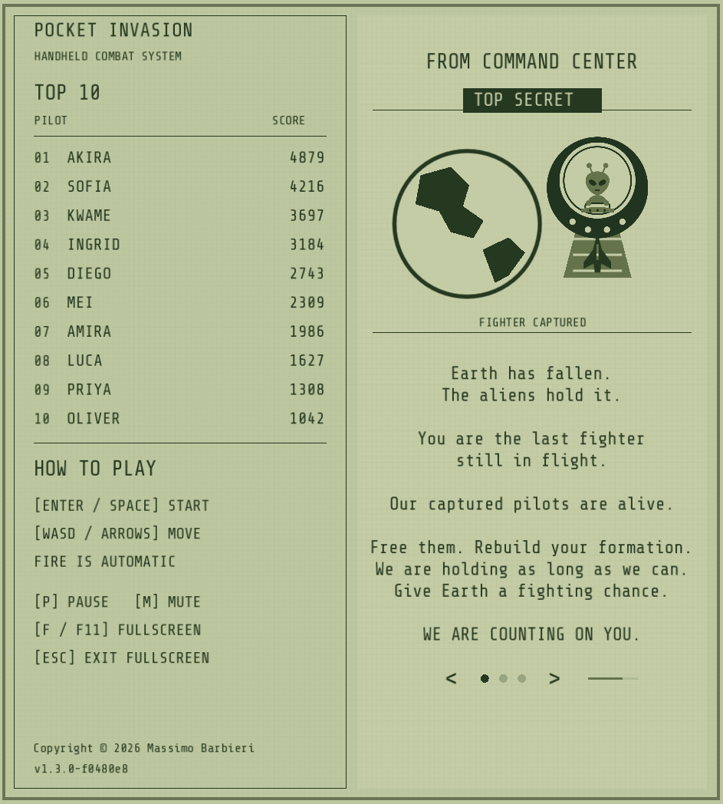
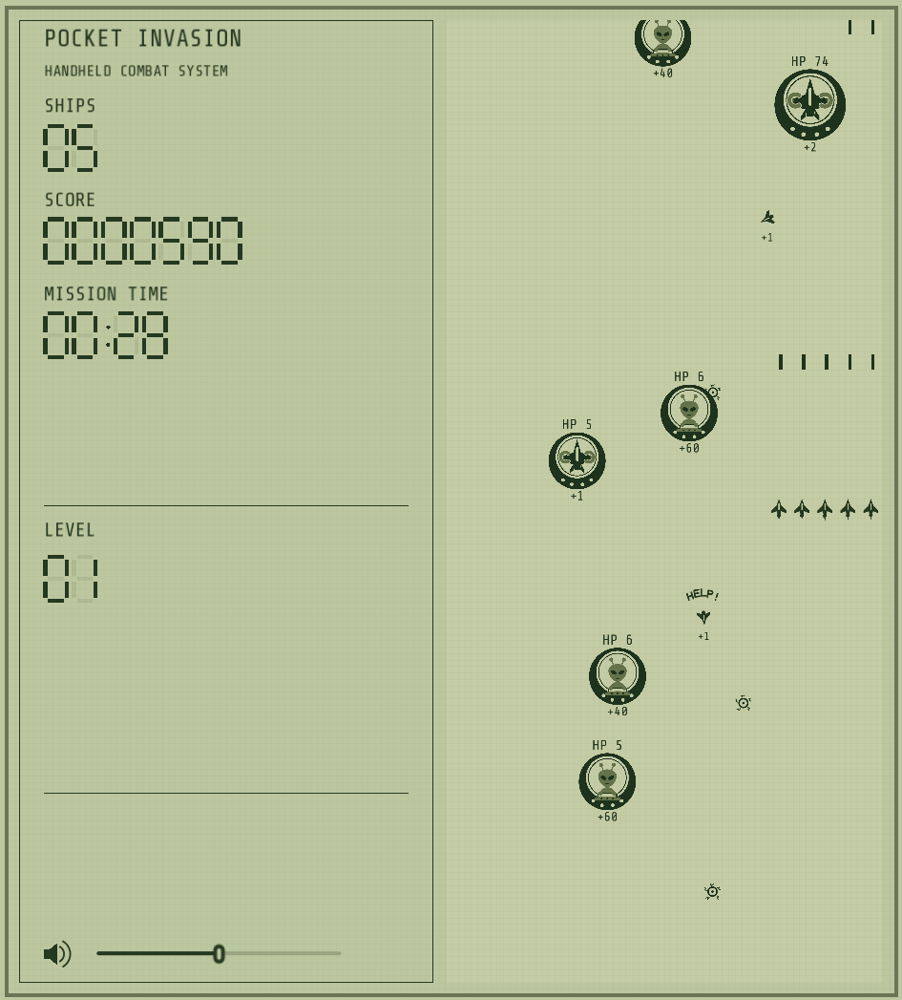

# Pocket Invasion

An offline formation shooter in an olive LCD style. Pilot a fleet, fire
automatically and rescue captured fighters to rebuild your formation. Play on
Windows x64 or in a desktop browser using the Web build.

<p>
  
  
</p>

## Prepare and play

From the project root in Windows PowerShell:

```powershell
.\scripts\Bootstrap.ps1 -Download
.\scripts\Run.ps1
```

Bootstrap uses pinned, portable Godot. Omit `-Download` to use a verified local
engine or the official ZIP in `artifacts/`. After setup, play and development
work offline. Use `.\scripts\Run.ps1 -Editor` to open the editor.

Enter or Space starts. Move with arrows or WASD. See the
[player manual](docs/MANUAL.md) for pickups, controls and the local Top 10.

## Project documentation

- [Development](docs/DEVELOPMENT.md) covers setup details, checks, Windows and
  Web exports, and GitHub releases.
- [Architecture](docs/ARCHITECTURE.md) covers simulation, rendering and state.
- [Changelog](docs/CHANGELOG.md) records releases and pending changes.

## License

Copyright (C) 2026 Massimo Barbieri. Source, documentation and original art are
licensed under [GPL-3.0-or-later](LICENSE). See
[distribution notices](docs/DEVELOPMENT.md#distribution-notices) for third-party
licenses and corresponding source.
